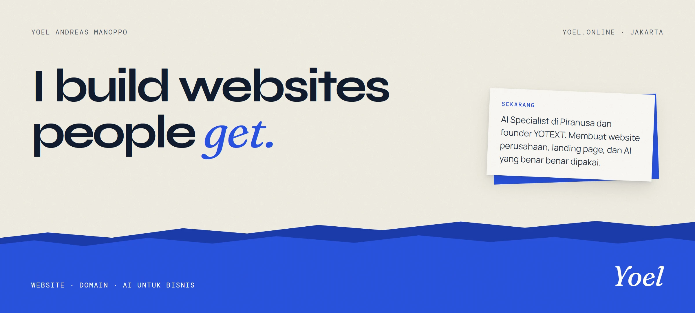
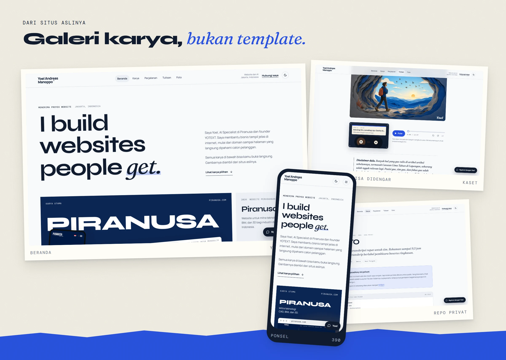
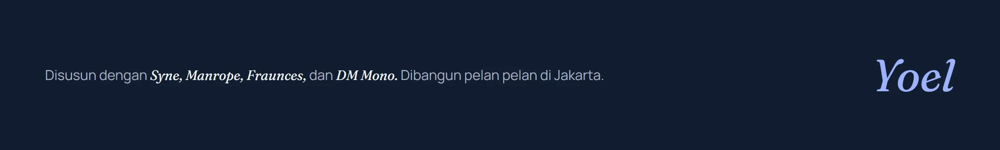

<p align="center">
  
</p>

<p align="center">
  <a href="https://yoel.online"><b>yoel.online</b></a>
  &nbsp;·&nbsp;
  <a href="https://yoel.online/projects">Karya</a>
  &nbsp;·&nbsp;
  <a href="https://yoel.online/blog">Tulisan</a>
  &nbsp;·&nbsp;
  <a href="https://wa.me/628992246000">WhatsApp</a>
</p>

---

## Sekarang

Saya Yoel, **AI Specialist di [Piranusa](https://piranusa.com)** dan **founder [YOTEXT](https://yotext.app)**.

Di Piranusa saya memegang sisi komersial, marketing, dan aplikasi internal, termasuk **Sipira**, CRM yang dipakai tim setiap hari, dan **Rekapin**. YOTEXT adalah produk saya sendiri: rapat menjadi transkrip, ringkasan, keputusan, dan tugas yang bisa dibuka lagi kapan saja. YOTEXT adalah kelanjutan dari dua project pribadi saya sebelumnya, ALTO dan YOTA.

Di luar itu, saya membantu bisnis tampil jelas di internet, mulai dari domain sampai halaman yang langsung dipahami calon pelanggan.

---

<p align="center">
  
</p>

## Karya pilihan

| Situs | Untuk siapa | Tautan |
|---|---|---|
| **Piranusa** | Mitra teknologi CAD, BIM, dan 3D untuk industri Indonesia | [piranusa.com](https://piranusa.com) |
| **YOTEXT** | Produk AI untuk transkrip dan catatan rapat | [yotext.app](https://yotext.app) |
| **Dinamika Polimerindo** | Manufaktur plastic injection molding | [polimerindo.com](https://polimerindo.com) |

Project lama seperti **Autocrawl, ALTO, YOTA, Atlas, Geocek, Sentinel, Juscat, ReUse, SoapyWorld, Scope of Work,** dan **AI Deskriptor** sekarang punya halaman sendiri di [yoel.online/projects](https://yoel.online/projects). Sebagian repository sudah privat. Halamannya tetap menampilkan cerita project dan susunan file serta foldernya, tanpa membuka kode.

## Yang bisa saya kerjakan

* **Website perusahaan.** Halaman yang menjelaskan apa yang dijual, untuk siapa, dan kenapa layak dipercaya.
* **Landing page produk.** Satu halaman yang fokus sampai pengunjung tahu langkah berikutnya.
* **Domain, hosting, dan SEO dasar.** Sitemap, robots, metadata, dan data terstruktur.
* **AI yang benar benar dipakai.** Asisten tanya jawab, otomasi formulir, atau alat internal, hanya kalau memang membantu.

---

## Tentang situs ini

Situs ini bergaya galeri karya: setiap karya ditampilkan dengan gambar dari situs aslinya, bukan mockup.

* **Tulisan yang bisa didengar.** Setiap artikel punya narasi suara AI saya, diputar lewat pemutar bergaya kaset. Teksnya menyala kata demi kata mengikuti suara dan bergulir otomatis. Klik kata mana pun untuk lompat ke bagian itu. Narasinya dibuat dengan ElevenLabs v3.
* **Ilustrasi Paper.** Gambar sampul dan ilustrasi tulisan dibuat dengan Qwen Image dalam gaya kertas berlapis: krem, kobalt, dan navy, ditandatangani "Yoel".
* **Teks yang bergerak.** Teks masuk, keluar, dan berbalik arah mengikuti scroll, dengan gaya yang diacak setiap kunjungan. Judul dan link membalik warna saat di hover. Untuk mesin pencari dan Lighthouse, semua teks tetap tampil apa adanya.
* **Ngobrol dengan Yoel.** Asisten di pojok kanan bawah menjawab pertanyaan soal pekerjaan dan layanan saya, ditenagai Qwen.
* **Status repository otomatis.** Halaman project mengecek GitHub. Begitu sebuah repository diprivatkan, situs ikut menampilkannya sebagai privat.

```text
FRAMEWORK     Next.js 14 App Router · React 18 · TypeScript
KONTEN        MDX · next mdx remote · RSS, Atom, dan JSON Feed
AI            Qwen (obrolan dan gambar) · ElevenLabs v3 (narasi)
TAMPILAN      CSS buatan sendiri · Syne · Manrope · Fraunces · DM Mono
ANALITIK      Vercel Analytics · Speed Insights
```

### Menjalankan secara lokal

```bash
npm install
npm run dev
```

Isi `.env.local` dengan `QWEN_API_KEY` untuk obrolan. `QWEN_BASE_URL`, `QWEN_MODEL`, dan `JINA_API_KEY` bersifat opsional.

---

## Hubungi saya

| Langsung | Di tempat lain |
|---|---|
| [yoelandreasmanoppo@gmail.com](mailto:yoelandreasmanoppo@gmail.com) | [github.com/Y0EL](https://github.com/Y0EL) |
| [+62 899 224 6000](https://wa.me/628992246000) (WhatsApp) | [linkedin.com/in/y0el](https://www.linkedin.com/in/y0el) |
| [yoel.online](https://yoel.online) | [@yoelmanoppo](https://www.instagram.com/yoelmanoppo) di Instagram · [@vehunt](https://x.com/vehunt) di X |

Dan sejak 2020, saya juga bermusik sebagai [Cubicube](https://open.spotify.com/artist/2ztUmew6tgNQ8JtRRep4Td) di Spotify.

<p align="center">
  
</p>
